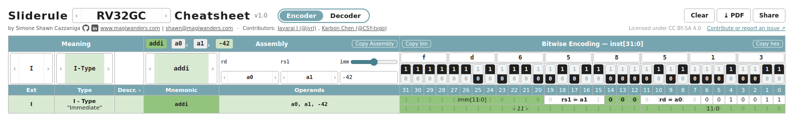
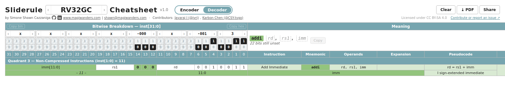

# RISC-V Sliderules

An instruction **encoder** and **decoder** in the browser, laid out like the paper "sliderule" cheatsheets, for
RISC-V RV32GC, the Zilog Z80, the MOS 6502 and the Hack computer of nand2tetris (choose one in the title):
pick an instruction and read its bits, or set bits and read the instruction.

**→ [sliderules.magiwanders.com](https://sliderules.magiwanders.com)**



## Using it

Switch between the two sheets with the **Encoder | Decoder** pill next to the title.

**Encoder** (the default). Above each column title sits its selector: scroll over it (or use the arrow keys) to cycle
through its options, or click it for a list (the mnemonic list has a search box).

- **Ext** and **Type** narrow the table down; picking a **Mnemonic** (or clicking one in the table) moves them to
  that instruction.
- **Operands**: one selector per operand. Immediates have a slider and a field that takes decimal, `0x…` or `0b…` and
  only accepts valid values.
- The bits, with their hex digits above, show the encoding. Copy the assembly next to *Assembly*, the binary
  and hex with the buttons either side of *Bitwise Encoding*.
- *Description* and *Explanation* are folded into the narrow **Descr. ›** column: click it to unfold both.



**Decoder**. Set the bits and the instruction builds up next to them, operand by operand. Hover an operand to see
its bits.

- Click the 1 or 0 half of a bit (click again for x, "don't care"), or focus a bit and type: each `0` / `1` sets it
  and moves to the next one, so you can type a whole pattern. `x`, Delete and Backspace clear bits.
- Or set four bits at once with the hex digit above them (scroll it, or click it for a list).
- Paste into a focused bit: a hex word (`0x00a50513`) or a bit pattern (`0101…`, `x` for don't care) fills the row.
- Copy bin / Copy hex (by *Bitwise Breakdown*) and Copy (by the instruction) work once the instruction is complete.
- Click a mnemonic in the table to load its encoding.

**Both views**, top right: **Clear** goes back to the whole sheet, **⤓ PDF** downloads the sheet as you see it (A3;
Clear first for the whole sheet), **Share** copies a link that reopens exactly this session: the sheet, selectors,
operands and bits are all in the link.

## Embedding

One line in any page:

```html
<script type="module" src="https://sliderules.magiwanders.com/embed.js"></script>
```

The sheets appear where an element with `id="sliderules"` is, or at the end of the page if there is none.

## Self-hosting

```sh
git clone https://github.com/magiwanders/riscv_sliderules_cheatsheets.git
cd riscv_sliderules_cheatsheets
npm install
npm run build      # static site in dist/: serve it with any web server
```

For embedding from other sites, the server must send `Access-Control-Allow-Origin` for the `.js` files.
Development: `npm run dev`. Tests: `npm test`.

## Testing

`npm test` runs everything below. The version of each sheet is shown next to the title.

| Instruction set | Version | Tested against | Coverage |
| --- | --- | --- | --- |
| RV32GC | v1.0 | GNU as 2.45 | 976 vectors over 212 of the 226 instructions and pseudo-instructions, plus known encodings and round trips of all of them |
| 6502 | v0.1 | py65 1.2.0 | 725 vectors over the 151 official opcodes; the opcode table equals py65's across all 256 opcodes |
| Z80 | v0.1 | skoolkit 10.1 | 617 vectors over the 166 documented forms; all 1,786 opcodes behind every prefix agree, apart from the undocumented ones left out on purpose and `ED 63` / `ED 6B`, which skoolkit only knows as an option |
| Hack | v0.1 | Known encodings | The assembly of the nand2tetris examples, and round trips of every instruction; every word of `Pong.hack` was once checked to decode and reassemble to itself (not part of `npm test`) |
| RV64GC, 8086, MIPS32, MIPS64, x86, x86_64, ARM Thumb, ARM32, ARM64 | — | — | Coming soon |

**RV32GC is bit-perfect against GNU as:** every encodable instruction and pseudo-instruction is encoded by the sheet with
random operands and the edges of its immediate's range, the same lines are assembled by GNU as, and the words must match
bit for bit. The 14 pseudo-instructions left out (`call`, `tail`, `la`, global loads and stores, ...) depend on the linker.
The reference is stored in `test/vectors/gnu-as.json` and regenerated with `npm run vectors`.

The 6502 and Z80 references are regenerated with `npm run vectors:retro`. These tests cover bits, mnemonics and instruction
lengths: the flags, pseudocode and descriptions of the v0.1 sheets are not checked against a reference yet.

## Contributing

Issues and suggestions: [open an issue](https://github.com/magiwanders/riscv_sliderules_cheatsheets/issues).
Pull requests are welcome. [CLAUDE.md](CLAUDE.md) explains how the code is organised and how to add an instruction
set extension or a whole instruction set (written for coding agents, readable by humans).

Started as the Summer 2023 RISC-V / LFX Mentorship "Bringing the Sliderules Cheatsheets to the Web".
Licensed under [CC BY-SA 4.0](LICENSE). Contributors: Simone Shawn Cazzaniga ([magiwanders](https://github.com/magiwanders)),
Jayaraj J ([jyrj](https://github.com/jyrj)), Karbon Chen ([CSY-tvgo](https://github.com/CSY-tvgo)).
